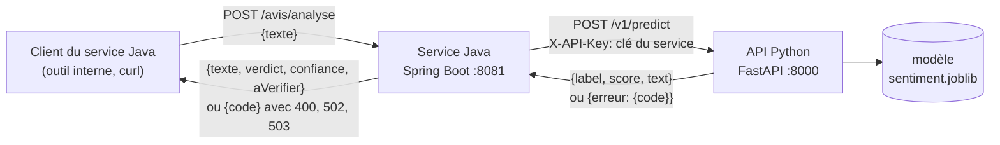

# TP Spring Boot : consommer l'API de sentiment depuis un service Java

**Module :** Développement et déploiement d'applications intelligentes
**Programme :** section 2.7 (intégration d'un modèle dans une application d'entreprise), complément du TP 2
**Placement proposé :** semaine 5, après la démonstration 2.7 ; 3 h (2 h en séance, 1 h en autonomie)
**Travail :** en binôme, dans votre dépôt `sentiment-app`
**Auteur :** A. Larhlimi

## 1. Contexte

Au TP 2, votre API Python expose `POST /v1/predict`, protégée par une clé d'API (en-tête `X-API-Key`), avec un format d'erreur unique. Une page web et Streamlit l'appellent déjà.

Dans beaucoup d'entreprises, le système d'information est écrit en Java. Le service client d'une boutique en ligne veut afficher le sentiment de chaque avis dans son outil interne, une application Spring Boot. Personne ne veut réécrire le modèle en Java : le service Java **délègue** l'analyse à votre API Python, par HTTP.

Le service Java a **ses propres clients** et **son propre contrat**. Il ne recopie pas les réponses de l'API Python : il les traduit.

## 2. Objectifs

À la fin du TP, vous savez :

1. structurer une application Spring Boot (application, contrôleur, composant, configuration) et la construire avec Maven ;
2. écrire un client HTTP typé avec `RestClient` qui lit un contrat JSON et ses erreurs ;
3. traduire les erreurs d'un service amont selon **qui doit agir** (le client, l'exploitant, personne) ;
4. tester à trois niveaux : faux serveur, vrai serveur local, API réelle ;
5. expliquer pourquoi un test avec faux serveur ne suffit pas, à partir de deux pannes réelles que vous allez provoquer.

## 3. Le contrat du service Java

### Routes

| Route | Entrée | Sortie (200) |
| --- | --- | --- |
| `POST /avis/analyse` | `{"texte": "..."}` | `{"texte", "verdict", "confiance", "aVerifier"}` |
| `GET /avis/sante` | aucune | `{"service": "OK", "api": "OK", "modele": "..."}` |

`verdict` reprend le `label` de l'API (`POSITIVE`, `NEGATIVE`, `INDETERMINE`), `confiance` reprend le `score`, et `aVerifier` vaut `true` seulement pour `INDETERMINE` (avis à confier à un humain).

### Traduction des erreurs

| Code reçu de l'API Python | Statut renvoyé par Java | Qui doit agir |
| --- | --- | --- |
| `ENTREE_INVALIDE` | 400 | le client du service Java : son avis est vide ou trop long |
| `NON_AUTHENTIFIE`, `ACCES_REFUSE` | 502 | l'exploitant : la clé est celle du service Java, c'est une erreur de configuration du serveur |
| `MODELE_INDISPONIBLE`, `API_INJOIGNABLE` | 503 | personne : réessayer plus tard |
| tout autre code (`ERREUR_INTERNE`, `REPONSE_INATTENDUE`...) | 502 | le service en amont a failli |

Le corps d'erreur du service Java est `{"code": "<code reçu>"}`. `API_INJOIGNABLE` (connexion refusée, délai dépassé) et `REPONSE_INATTENDUE` (corps illisible, par exemple une page HTML d'un proxy) sont produits par le client Java lui-même.

### Configuration

| Propriété Spring | Variable d'environnement | Défaut |
| --- | --- | --- |
| `sentiment.api.url` | `SENTIMENT_API_URL` | `http://127.0.0.1:8000` |
| `sentiment.api.key` | `SENTIMENT_API_KEY` | vide (toute requête sera refusée) |
| `server.port` | `PORT` | `8081` |

La clé n'est **jamais** écrite dans un fichier du dépôt.

## 4. Prérequis

* Le TP 2 terminé : `api/v1.py` et `api/securite.py` présents, une clé de rôle `client` dans votre `.env`.
* Un JDK 21 (Temurin conseillé). Maven n'est pas à installer : le kit fournit le Maven Wrapper (`mvnw`, `mvnw.cmd`), qui télécharge la bonne version au premier lancement.
* Le kit `kit-tp-spring` (diffusé deux jours avant la séance).

## 5. Travail demandé

Chaque étape se termine par un **contrôle** (J0 à J9) : la commande à lancer et le résultat attendu sont dans `MARCHE-A-SUIVRE-TP-SPRING.md`. Notez dans votre rapport ce que vous obtenez à chaque contrôle.

| Contrôle | Travail | Attendu |
| --- | --- | --- |
| **J0** | Vérifier Java 21 et lancer l'API Python | `java -version` affiche 21 ; `GET /v1/health` répond `OK` |
| **J1** | Poser le kit, construire le projet | compilation réussie ; **2 tests sur 21** passent |
| **J2** | `SentimentClient` : constructeur, `analyser()`, `codeErreur()` | 3 tests de `SentimentClientTest` passent |
| **J3** | `SentimentClient.sante()` | `SentimentClientTest` 4 sur 4 ; **8 tests sur 21** au total |
| **J4** | `AvisController` : `analyser()`, `sante()`, `statutPour()` | `AvisControllerTest` 12 sur 12 ; **20 tests sur 21** |
| **J5** | Premier essai réel, diagnostic, correction de `ClientHttpConfig.transport()` | **21 tests sur 21** |
| **J6** | Essai de bout en bout : le service Java contre l'API réelle | 6 vérifications OK |
| **J7** | Tests JUnit contre l'API réelle (`ApiReelleTest`) | 5 tests sur 5 |
| **J8** | Reproduire les deux pièges, répondre aux questions | rapport `RAPPORT-TP-SPRING.md` |
| **J9** | Livrer | CI « TP Spring Boot » verte, étiquette `tp-spring` poussée |

### Ce que vous écrivez, et ce qui est fourni

Fourni et à **ne pas modifier** : `pom.xml`, le Maven Wrapper, `application.properties`, `AvisServiceApplication`, `SentimentApiException`, les records du contrat, le gestionnaire d'erreurs du contrôleur, et **tous les tests** (ils sont le contrat).

À écrire : les corps de méthodes marqués `TODO J2` à `TODO J5`, dans trois fichiers : `SentimentClient.java`, `AvisController.java`, `ClientHttpConfig.java`.

### J5 en détail : la panne que les tests ne voient pas

Après J4, 20 tests sur 21 passent. Lancez pourtant l'essai réel (`scripts/e2e_spring.sh` ou `scripts\e2e_spring.ps1`) : des avis parfaitement valides sont refusés. Votre travail :

1. lire le journal de l'API Python (`java/avis-service/target/e2e/uvicorn.log` ou `uvicorn.err`) et relever le message d'avertissement ;
2. comprendre ce que le client Java envoie de plus que ce qu'uvicorn sait lire (le test `avecLeTransportDuCoursAucuneTentativeHttp2` vous met sur la piste) ;
3. corriger `transport()` : protocole, délai de connexion, délai de lecture ;
4. relancer l'essai réel jusqu'à 6 vérifications OK.

### J8 en détail : provoquer les pannes, volontairement

Le service accepte une option `--sentiment.api.transport` qui ne sert qu'à ce TP :

* `httpurlconnection` : le client HTTP historique du JDK, celui que Spring Boot 3.3 prend par défaut ;
* `jdk-defaut` : le client moderne du JDK, sans réglage ;
* `jdk-http11` : votre correction (le défaut).

Relancez l'essai réel avec chacune des deux premières valeurs et observez ce qui casse.

## 6. Questions (rapport, J8)

Répondez en quelques phrases, en citant vos journaux quand c'est demandé.

1. Avec `httpurlconnection` et une clé de service erronée, quel statut le service Java renvoie-t-il ? Quelle exception trouvez-vous dans `java-cle.log` ? Pourquoi le code `NON_AUTHENTIFIE` est-il perdu ?
2. Avec `jdk-defaut`, quel avertissement uvicorn écrit-il ? Pourquoi les tests avec `MockRestServiceServer` passaient-ils quand même ?
3. Pourquoi une clé refusée par l'API Python devient-elle un **502** pour le client du service Java, et non un 401 ?
4. Le record `Prediction` porte `@JsonIgnoreProperties(ignoreUnknown = true)`. Quelle évolution de l'API Python cela rend-il sans danger ? Quelle évolution casserait quand même le service Java, et comment l'API doit-elle la publier ?
5. Faut-il ajouter l'origine du service Java à `CORS_ORIGINS` de l'API Python ? Justifiez.
6. Pourquoi deux délais (connexion 3 s, lecture 10 s) ? Que se passerait-il, pour les clients du service Java, si l'API Python restait bloquée sans délai de lecture ?

## 7. Livrables (J9)

Dans votre dépôt, sur la branche principale :

* `java/avis-service/` complété ;
* `RAPPORT-TP-SPRING.md` à la racine : résultats des contrôles J0 à J8 (commande, obtenu, conforme ou non) et réponses aux six questions ;
* la CI « TP Spring Boot » verte (deux jobs : tests JUnit, bout en bout) ;
* l'étiquette `tp-spring` sur le commit rendu : `git tag tp-spring` puis `git push origin tp-spring`.

Aucune clé d'API dans le dépôt : un `git grep` sur votre clé client doit ne rien trouver.

## 8. Barème proposé (sur 20)

| Élément | Points |
| --- | --- |
| J2 et J3 : client HTTP (tests `SentimentClientTest`) | 5 |
| J4 : contrôleur et traduction des erreurs (tests `AvisControllerTest`) | 4 |
| J5 : diagnostic écrit et correction du transport (tests `TransportHttpTest`) | 4 |
| J6 et J7 : essai réel et tests contre l'API réelle | 3 |
| J8 : réponses aux questions, appuyées sur les journaux | 3 |
| J9 : CI verte, étiquette, aucune clé dans le dépôt | 1 |

Un test modifié pour le faire passer annule les points de l'étape concernée.
